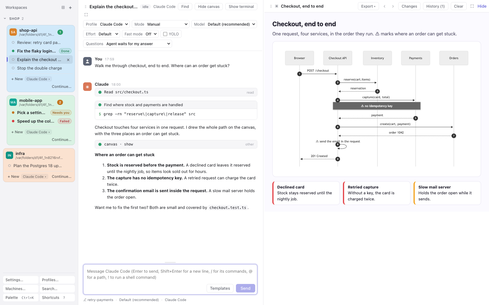
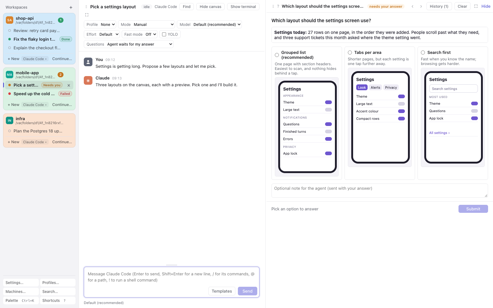
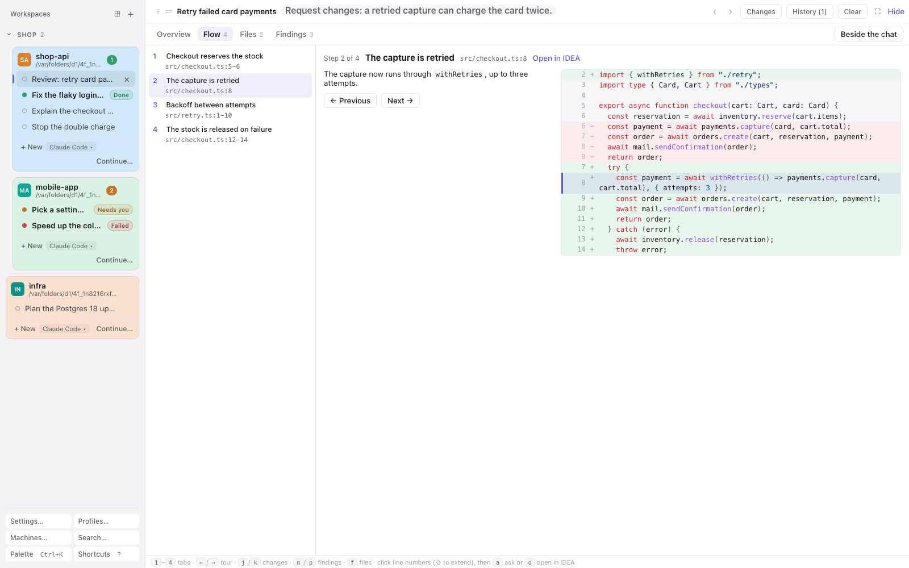
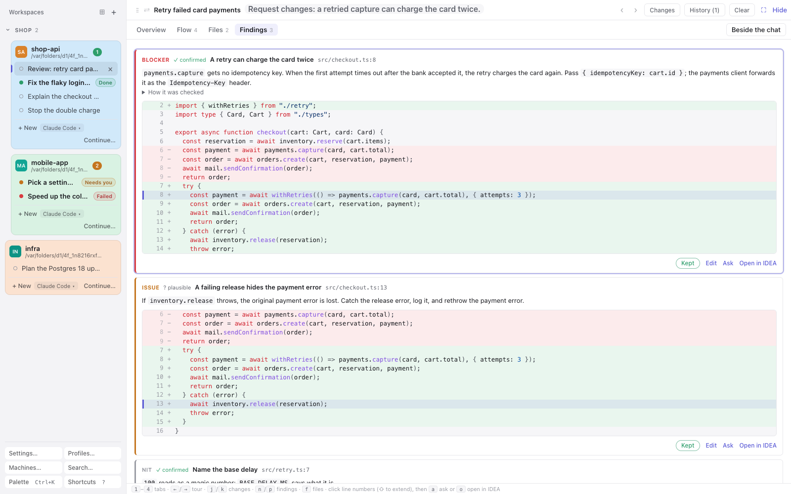
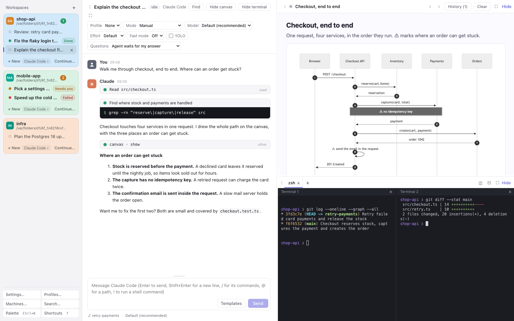

# Mirador

**See what your coding agent means.**

Mirador runs your coding agents (Claude Code and opencode) and gives them a **canvas** beside the conversation. On the canvas they draw what they mean, ask you with pictures, and hand you code reviews you can walk through. It runs on your own computer, with your own agent settings, and you can follow it from your phone.



*A mirador is a lookout: the place you climb to see the whole landscape at once.*

## Why Mirador exists

Coding agents changed the pace of our work. In a few minutes an agent reads a codebase, changes ten files and explains what it did in a long stream of text. Writing code is no longer the slow part. **We are**: reading what the agent did, understanding it and reviewing it fast enough to stay in control.

And we do that reading in a terminal. A terminal is a wall of text scrolling by: tool calls, diffs and explanations, all in one font, all at the speed the agent types. But people understand pictures far faster than text. A sequence diagram explains a request path at a glance, where the same in prose takes a page. A mockup settles a layout question in a second, where three paragraphs describing the options don't.

Mirador was born from that gap. It keeps everything that makes a coding agent powerful (the real Claude Code and opencode, with your own settings, hooks and MCP servers) and gives the agent a canvas next to the conversation:

- **It shows you** what it means: architecture, flows, data, mockups, charts, even 3D scenes, instead of describing them.
- **It asks you** with pictures: two to eight options, each with a preview, and you click one.
- **It hands you a review** to walk through: the change as a guided tour of the code in the order it runs, with findings pinned to the lines they are about, ready to post to the pull request.

Understanding gets faster. Reviewing gets far, far faster. And you stay the one who decides.

**Mirador is a tool for developers, built by a developer**, to make our lives easier in the AI era: the agents are fast, and this is how we keep up with them.

## The three ideas

### Show: the agent draws what it means

The agent renders a page on the canvas: a diagram, a mockup, a chart, a comparison, a 3D scene. Pages are self-contained HTML in a sandbox, with Mermaid, D3 and three.js built in and working offline. If a page throws a script error, the agent is told and fixes it. Every page stays in the conversation's canvas history.

### Ask: questions you answer with a click



Instead of a numbered list of options in text, the agent asks on the canvas: a question, an optional page explaining it, and up to eight options with a preview each. You click one, or type your own answer, and add a note if you like. The answer goes back to the agent, either as the tool's result or as your next message.

### Review: a guided tour of the change



The agent publishes its code review as a page you work through, not a wall of comments:

- **Overview**: the verdict, the summary and the findings by severity.
- **Flow**: a tour of the change in the order the code runs, one step at a time, with the lines marked.
- **Files**: every diff, with syntax colours.
- **Findings**: pinned to their lines. Each shows its severity and whether the agent confirmed it or only suspects it.

Keep or drop each finding, reword it, ask the agent about any lines, and open them in your IDE. Then post the findings you kept to the GitHub pull request as your pending review.



## Get it

Mirador runs on **macOS** (Apple Silicon) and **Linux** (x64 and arm64), and in any browser on your network. The **Android** app follows it from your phone. Windows is planned.

### The desktop app

Download from the [releases](https://github.com/sodre90/mirador/releases). The app carries Mirador and the Bun it runs on, so it doesn't require Bun or a checkout. It runs the agents you have installed: Claude Code (`curl -fsSL https://claude.ai/install.sh | bash`) and opencode.

**macOS**: `Mirador-macos-arm64.zip`. The app is signed ad hoc, not by an identified developer, so clear the download's quarantine once:

```bash
unzip Mirador-macos-arm64.zip -d /Applications
xattr -dr com.apple.quarantine /Applications/Mirador.app
open /Applications/Mirador.app
```

**Linux**: `Mirador-linux-x64-Setup.tar.gz` or `Mirador-linux-arm64-Setup.tar.gz` (`uname -m` says which). It needs GTK 3, WebKitGTK 4.1 and the Ayatana AppIndicator library ([details](desktop/README.md#linux)):

```bash
sudo apt install libgtk-3-0 libwebkit2gtk-4.1-0 libayatana-appindicator3-1 librsvg2-2   # Debian, Ubuntu
sudo dnf install gtk3 webkit2gtk4.1 libayatana-appindicator-gtk3 librsvg2              # Fedora
mkdir mirador-setup && tar -xzf Mirador-linux-*-Setup.tar.gz -C mirador-setup && mirador-setup/installer
```

Then start *Mirador* from your applications menu.

**Signing in**: Mirador runs the `claude` on your PATH (or in `~/.local/bin`, `/opt/homebrew/bin` or `/usr/local/bin`), or the program set in *Settings › Agents*, so it uses the sign-in and version you already have. Without a sign-in, a conversation offers *Log in*, which opens that Claude Code's own sign-in in a terminal tab. For opencode, install [opencode](https://opencode.ai) and Mirador finds it.

### The phone app

The Android app is in [sodre90/mirador-mobile](https://github.com/sodre90/mirador-mobile/releases). In Mirador, open *Settings → Devices*, switch on *Reachable on the network* (or use a Tailscale address), then *Invite a device*. Scan the QR code with the app.

### From source

```bash
bun install
bun start
```

Open the `http://127.0.0.1:4600/auth?code=…` link the host prints; it signs one browser in with a cookie, works once, and expires after 10 minutes. `bin/mirador sign-in` makes a new link for the next browser. Ctrl+C stops the host, and the agents with it.

## Everything Mirador does

- [The canvas](#the-canvas)
- [Questions](#questions)
- [Code review](#code-review)
- [Conversations and agents](#conversations-and-agents)
- [The message box](#the-message-box)
- [The transcript](#the-transcript)
- [Sidebar and workspaces](#sidebar-and-workspaces)
- [Layout](#layout)
- [Find and search](#find-and-search)
- [Terminals](#terminals)
- [Jobs left running and messages from scripts](#jobs-left-running-and-messages-from-scripts)
- [Notifications and waiting for you](#notifications-and-waiting-for-you)
- [Devices, other machines and the network](#devices-other-machines-and-the-network)
- [Settings](#settings)
- [Keyboard](#keyboard)
- [The desktop app](#the-desktop-app-1)
- [The phone app](#the-phone-app-1)
- [Working on Mirador in Mirador](#working-on-mirador-in-mirador)
- [Security](#security)
- [Command line and environment](#command-line-and-environment)

### The canvas

- **`show`**: the agent renders a page next to the conversation: diagrams, mockups, charts, comparisons, 3D scenes.
- **Libraries built in**: three.js (with OrbitControls), D3 v7 and Mermaid load from Mirador itself, so pages work offline.
- **Script errors come back**: the agent hears either "rendered without script errors" or the list of errors, and can fix its page.
- **History**: everything shown or asked is kept per conversation, across reloads and restarts. *Older* and *Newer* step through it, and *History* lists it newest first, with each question's outcome. *Clear* empties the canvas without deleting anything.
- **Hide, show and full screen**: the canvas keeps receiving pages while hidden.
- **How often Claude Code uses it** (*Settings → Canvas*): *As needed*, or *Often*, which adds guidance to Claude Code's system prompt. The canvas tools are always loaded, so Claude Code's tool search never hides them. opencode gets the same instructions.

### Questions

- **`ask`**: a question with 2 to 8 options, each with a description and an optional HTML preview, plus an optional page explaining the question.
- **Previews are shown whole**: option columns widen to the widest preview, and a page wider than the canvas is scaled down to fit.
- **Your own answer**: *Something else…* takes a typed answer, and every answer can carry a note.
- **Context stays**: a page the agent showed just before asking stays above the question.
- **Two ways to answer**, chosen per conversation: *Agent waits for my answer* returns your choice as the tool's result. *My answer is sent as the next message* lets the agent end its turn, and your choice arrives later as your message.
- **Answered or withdrawn** questions leave a short note in place of the question.

### Code review

- **`review`**: the agent publishes a review of `base...head` in a checkout, like a pull request: a title, a verdict, a summary, a tour of the code flow and findings. The diff comes from git, so the agent never pastes code.
- **Checked before shown**: anchors outside the diff, or unknown conversations, send the whole list of problems back to the agent, and nothing half-wrong is shown.
- **Full screen or beside the chat**: *Settings → Canvas → Open reviews* sets the default, and a button switches it. A new review brings a hidden canvas back.
- **Overview**: verdict, `+`/`−` counts, commit range, the summary (Markdown, tables included), the flow as a list and the findings by severity.
- **Flow**: the tour in the order the code runs, one step at a time, with the step's lines marked. ←/→ move between steps.
- **Files**: a filter box, the tour's files first, every diff with syntax colours, and *show the lines between changes* in steps or all at once.
- **Findings**: severity (blocker, issue, question, nit) and *✓ confirmed* or *? plausible*. *How it was checked* holds the agent's evidence, which is for you and is never posted.
- **Curate**: keep or drop each finding, reword it, ask the agent about it, or open it in IDEA.
- **Ask about any lines**: click line numbers (Shift+click extends), then `a` asks the agent with the code attached and `o` opens IDEA at that line. *Ask and update the review* (⌘Enter) has the agent republish when its answer changes anything.
- **Post to GitHub**: kept findings become comments on your pending review on the pull request, through `gh` (GitHub Enterprise too). You submit it on GitHub. Findings outside the pull request's diff stay in the review, marked as such, and GitHub refusals are reported per finding.
- **Re-review**: republishing keeps your keep/drop choices and rewordings. The agent is told which findings you dropped or already posted.
- **Answer the pull request's conversations**: on a re-review the agent can reply to existing review threads, shown as GitHub has them (outdated, resolved). You keep, edit or drop each answer, and choose *Resolve when posted*.
- **Keys**: `1`–`5` tabs, `j`/`k` changes, `n`/`p` findings, `f` files, `a` ask, `o` open in IDEA.

### Conversations and agents

- **Claude Code and opencode** over ACP, in the workspace's folder, with your normal settings: Claude Code with `~/.claude` (settings, hooks, MCP servers; claude-notifier is muted for Mirador's sessions), opencode with `~/.config/opencode` (providers, agents, plugins, MCP servers, and its permission settings: Mirador forces nothing, so with opencode's defaults most tools run without asking). opencode is found on `PATH`, else in `/opt/homebrew/bin`, `/usr/local/bin` or `~/.opencode/bin`.
- **Profiles** (*Profiles…*): an agent plus the environment it starts with, e.g. Claude Code through a work gateway or a local llama.cpp server, or opencode with another config (`OPENCODE_CONFIG=…`, or inline `OPENCODE_CONFIG_CONTENT='{…}'`).
  - Every conversation runs on a profile. On first start Mirador offers one filled in: an installed agent as it is set up on this machine, with an empty environment. Conversations from before profiles move onto such a profile per agent.
  - The last profile stays until you create another; the workspaces of a deleted profile move to another one.
  - Environment lines are `KEY=value`, `-u KEY` and `# comment`, so the lines of a `claude_env=( … )` alias paste as they are.
  - An optional pre-launch command can start a proxy first; if it fails, you see its output.
  - Each profile has defaults for mode, YOLO and questions, its own agent process and its own log (`logs/<agent>-<name>-<id>.log`). Saving a changed profile restarts its agent.
  - Profiles, including their tokens, are stored in the SQLite database with owner-only permissions. Secrets are masked on screen.
- **Switch profile mid-conversation** (*Profile* in the conversation's header, even after the profile was deleted): the new profile's agent resumes the same session with its model. Switching while the agent works stops the turn, and once the session is back the agent continues where it left off. A profile that keeps sessions elsewhere (another `CLAUDE_CONFIG_DIR`, or opencode's `XDG_DATA_HOME`) starts a fresh session instead.
- **Every agent option** in the header: model, mode, effort and whatever else the agent offers. Lists of more than 20 choices get a search box (opencode has 500+ models).
- **YOLO** (off by default): Mirador approves every permission request of that conversation without asking, including requests already waiting. Claude Code's own *Bypass permissions* mode is separate.
- **Continue…** (in each workspace's card) lists the sessions the agent recorded for that folder, including ones started in a terminal, and replays the chosen one into a new conversation. *Continue* keeps the same session; *Fork* copies it.
- **A session still open in a terminal** is flagged (header badge, sidebar dot, a note above the message box), with what it is doing there: working, waiting for you, or idle. Mirador reads this from Claude Code's session registry (`~/.claude/sessions`, or the profile's `CLAUDE_CONFIG_DIR`); it doesn't show the terminal's new messages.
- **Status**: idle, starting, running or error, with what each means on hover.
- **Stop**: Esc in the message box, or the Stop button.
- **`/clear`** starts the agent afresh while the transcript stays on screen. It works queued, and across restarts.
- **Log in again**: when the agent's sign-in expires, *Log in* (or `/login`) opens the agent's own sign-in in a terminal tab, with the conversation's profile.
- **Usage limits**: when Claude's usage limit is reached, queued messages wait, and Mirador asks the agent to continue about a minute after the limit resets (at most twice in a row). *Continue now* and *Stop waiting* are there too. It survives a host restart.
- **Rename**: click the title in the header, double-click it in the sidebar, or *Rename conversation…* in the palette. A name you choose sticks; otherwise the title is your first message until the agent names the session.
- **Delete** with a two-click confirm; deleting while the agent works ends the turn quietly.
- **Nothing is lost**: conversations survive reloads and host restarts, and the agent's session resumes.

### The message box

- **Images**: paste or drag them in; each lands as `[Image #n]` where the caret is. Deleting the marker drops the image.
- **`@` paths**: completes workspace files, folder by folder, as well as absolute and `~` paths, anywhere in the message.
- **`/` commands**: the agent's commands plus Mirador's `/clear` and `/login`. Tab writes one out, Enter runs one that takes no arguments, Esc closes the list.
- **`!` shell commands**: run in the workspace's folder with your login shell. The output shows inline with Run/Stop, and goes to the agent with your next message unless you drop it.
- **Prompt history**: ↑/↓ step through earlier messages, this conversation's first and then the workspace's, images included.
- **Prompt templates** with `{{parameters}}`: *Templates* sends one or inserts it, with a form for the parameters. Add, edit and delete them in *Settings → Conversations*; a *Deep PR review* template comes with Mirador.
- **Queue while the agent works**: with Claude Code each message either joins the running turn (steering, once its tools finish) or waits until after the turn; Enter and ⌥Enter pick, and Settings can swap them. opencode can't be steered, so its messages wait. Drag queued messages to reorder them, *Edit* one back into the box, or press ↑ in an empty box to pull back the last. The queue lives in the database, so it survives reloads and restarts.
- **Drafts**: text and images are kept per conversation.
- **Resizable**: drag the box's top edge; double-click resets it.
- **macOS keys**: fn+←/→ go to the start and end of the line; spelling autocorrection and inline predictions are off by default and can be switched on.

### The transcript

- **Grouped by author**, with avatars and times. Point at a line for its time, or switch on *Show timestamps* for every line.
- **Markdown** with tables, links that open in a new tab, and code blocks.
- **Thinking** (folded), the agent's **plan** as a checklist, mode changes, turn ends and errors.
- **Permission requests** show the tool and its command, with the agent's own allow and reject options, and the outcome afterwards.
- **Tool calls** with diffs for edits, raw input and output a click away, and readable MCP tool names.
- **Shell commands** look like a terminal. *Settings → Appearance → Shell commands* picks how much shows: output a click away, output only on failure, one line, or everything.
- **Subagents** nest under their Agent card. While they work, a count shows in the header and a strip above the message box says what each is doing ("now: Read", elapsed time); a click opens its latest work.
- **Images** show inline; click for full size.
- **Long conversations** load the newest 200 entries and the earlier ones as you scroll up. Switching between recent conversations is instant and keeps your scroll position, and resizing panes keeps your place.
- **Statusline**: git branch, model, context used (tokens and share of the window), your plan's 5-hour and weekly usage (weekly turns amber past 75%), cost and profile. Or run your own Claude Code `statusLine` command, exactly as Claude Code would.

### Sidebar and workspaces

- **Workspaces** are project folders (*Add workspace*, Tab completes paths), each a card with its conversations oldest first and *+ New* at the bottom. The chip beside *+ New* chooses the profile for new conversations, and each workspace remembers it. Removing a workspace never touches its files.
- **Drag to reorder** workspaces (by their heading) and conversations (within their workspace). Every window and reload keeps the order.
- **Colours**: eight pastels, picked from the workspace's initials badge or the palette, drawn as a tinted card, a heading or an edge stripe.
- **Waiting marks**: *Needs you*, *Done* and *Failed* (see [Notifications](#notifications-and-waiting-for-you)).
- **Devices connected**: a line at the bottom says how many devices are connected; it can be switched off.
- **Resizable**, remembering its width; double-click restores it.

### Layout

- **Three panes**: conversation, canvas and terminals. Drag a pane's grip onto another to swap them, in six arrangements.
- **Per conversation**: each conversation remembers its arrangement, split sizes, hidden panes and full screen. *Settings → Layout* sets the default for new ones; the palette resets it.
- **Full screen** any pane (button, or double-click its bar); Esc comes back.
- **Show or hide** the canvas and terminals from the header, the palette or ⌘\.

### Find and search

- **⌘F** finds in the open conversation, including entries not loaded yet and folded cards, which it unfolds. It shows the match count; Enter goes to the older match and Shift+Enter to the newer.
- **⌘⇧F** searches every conversation in every workspace, newest first, with snippets. Opening a result jumps to it with the find bar on it.



### Terminals

- **The workspace's shells**, in tabs, each with up to four splits side by side (*Split right*) or stacked (*Split down*); drag a divider to resize. Every window shares them, and they keep running while hidden and across reloads.
- **macOS keys**, the ones cmux and iTerm2 share: `⌘D` splits right and `⌘⇧D` down, `⌥⌘←→↑↓` move between splits, `⌘[`/`⌘]` go to the previous or next split, `⌘T` opens a tab, `⌘⇧[`/`⌘⇧]`, `⌘1…⌘9` and `⌃1…⌃9` switch tabs, and `⌘⇧↩` zooms the focused split (*Show all* brings the others back). In Chrome, `⌘T`, `⌘W`, `⌘⇧[`/`⌘⇧]` and `⌥⌘←→` stay Chrome's.
- **Closing**: `⌘W` closes the focused shell, and a middle click closes a tab. Either asks first while a command runs (Enter ends it, Esc keeps it).
- **Line editing** as in a macOS terminal: `⌘←`, `⌘→`, `⌘⌫`, `⌥←`, `⌥→`, and `⌘K` clears for good.
- **Copy on select** (*Settings → Terminal*). On Linux, `Ctrl+Shift+C` and `Ctrl+Shift+V` copy and paste, and `Ctrl+C` stays the interrupt.
- **Nerd Font aware**, with a dark terminal in both themes.

### Jobs left running and messages from scripts

- **`mirador when-done`**: instead of polling a job it started in the background, the agent runs `mirador when-done --pid <pid> "<message>"` (or `--container <name>` for Docker and Podman, and `--host <user@host>` for a job on another machine, over ssh) and ends its turn. When the job ends, the message arrives as your next message, so the agent carries on; with `--no-resume` only you get notified. Agents can also call the canvas server's `when_done` tool, which does the same; opencode's agents use that, as their commands carry no session id.
  - Mirador checks a process every second, a container every 5 seconds and another machine every 20 seconds. Over ssh it gives up after 30 failed checks in a row, saying the job may still run. A mistyped pid or a missing container is refused at once.
  - Waits are kept in the database, so they go on after a host restart, and a job that ended meanwhile is noticed then.
  - While it waits, the conversation shows the job above the message box, with *Stop waiting*.
  - **Click the job to follow it** in a terminal tab, locally or over ssh: its command line and how long it has run, then its output file (`tail -f`) or the container's logs, until it ends. Clicking again shows the same tab. Ctrl+C closes the tab and leaves the job running.
- **`scripts/mirador-message "<text>"`** (or text on stdin) sends text to the agent's conversation as your next message: at once if the agent is idle, else queued. It shows as *From a script*. It finds the conversation by the session id every command the agent runs inherits (Claude Code's `CLAUDE_CODE_SESSION_ID`, or the `MIRADOR_SESSION_ID` Mirador's plugin gives opencode's commands), with the `MIRADOR_URL` and `MIRADOR_SCRIPT_TOKEN` Mirador gives its agents. Anything else needs `--session <agent session id>`. The script token survives restarts, and unknown sessions or empty messages are refused with the reason.

### Notifications and waiting for you

- **System notifications** for a question, a permission request, a finished turn or an error, unless that conversation is on screen in a focused window. In a browser, switch them on in *Settings → Notifications*; clicking one opens the conversation. The desktop app shows them natively instead, and browser tabs on that computer then stay quiet so nothing arrives twice. Every joined device gets its own.
- **Waiting for you**: the sidebar marks each conversation whose agent waits for you. *Needs you* means a permission request or a question is unanswered. *Done* (or *Failed*) means a turn ended while you looked elsewhere, until you open it. *Settings → Appearance → Waiting for you* picks the look: a pill and a count per workspace, only a dot and a bold title, or the pills plus a list of everything waiting above the workspaces. Every window shows the same marks, and they survive host restarts.

### Devices, other machines and the network

- **Devices** (*Settings → Devices*): other browsers and the phone app join with an invite (*Invite a device*: a one-time code valid for 15 minutes, a link and a QR code), or ask to join and are let in by typing the number they show, on any open page or with `mirador approve`. The list shows which devices are connected, with how many pages each has open (or *in the background*, while only its app listens for notifications), and where they connect from, including the Tailscale login. Revoke any of them at once.
- **How other devices reach it** (*Settings → Devices*): one way at a time, and the host uses the chosen one from its next start. **At an address a proxy gives it** — *Find the address* asks each candidate whether it answers as this Mirador, on its own port and on the canvas port, and offers the ones that do: this machine's name on its tailnet, and the addresses devices have already reached it at. Where Tailscale is installed but nothing answers yet, *Expose Mirador on Tailscale* runs `tailscale serve` for both ports itself. **Over the network, with no address** — Mirador serves HTTPS itself on its own port, with a certificate authority of its own (download `mirador-ca.pem`) or your certificate (`MIRADOR_TLS_CERTIFICATE`, `MIRADOR_TLS_KEY`). Or **only on this machine**.
- **Other machines, side by side**: *Machines…* adds another Mirador computer by address or invite link. Its view opens in this window from the rail on the left, with a badge counting its waiting conversations, its notifications arriving here, and a colour of its own. A joining machine pins the certificate authority named in the invite, so a different one is refused.
- **Light on mobile data**: phones get the latest turns first, only what they missed after a reconnect, long outputs on request, and compressed messages.

### Settings

*Settings…* opens a dialog of pages (Up/Down switch between them). Each page says whether a setting is kept in this browser or on the host.

- **Appearance**: theme (Light, Dark, Match system), *Waiting for you* style, workspace colours, machine colours, shell commands, timestamps. The choices come with pictures.
- **Conversations**: *Sending while the agent works* (Enter or ⌥Enter to steer), prompt templates, and macOS typing aids.
- **Terminal**: copy on select.
- **Canvas**: how often Claude Code uses it, and where reviews open.
- **Layout**: the default arrangement for new conversations, and whether the canvas and terminals start hidden.
- **Devices** and **Notifications**, as above.

Hovering almost any control explains what it does behind the scenes, together with its keyboard shortcut.

### Keyboard

| Keys | What they do |
| --- | --- |
| `⌘K` | The palette: any conversation, new conversation, continue a session, workspace colour, rename, canvas and terminal, layout reset, machines, search, settings, restart the host |
| `⌥↑` `⌥↓` / `⌥⇧↑` `⌥⇧↓` | Previous or next conversation / workspace |
| `⌥1`…`⌥9` | The n-th conversation of the current workspace |
| `⌥T` / `⌥⇧T` | New conversation / add a workspace |
| `⌘\` | Show or hide the canvas |
| `⌘⇧←` `⌘⇧→` | Focus the message box / the canvas |
| `⌘F` / `⌘⇧F` | Find in the conversation / search everywhere |
| `⌘R` / `⌘⇧R` | Reload the page / restart the host |
| `?` | Every shortcut, terminal keys included |

Off macOS, Ctrl stands in for ⌘ and Alt for ⌥. The ⌥ bindings go by physical key, so they work on layouts where ⌥ types characters, but they then shadow those characters (e.g. ⌥1…9 on the Hungarian layout). They also work while a canvas page has focus, except those that create or restart something: a page the agent wrote can't start conversations.

### The desktop app

A native window around Mirador, for macOS and Linux ([full details](desktop/README.md)).

- **Menu bar or tray app**: closing the window leaves it running, and on macOS the Dock icon hides until the window comes back. On macOS `⌘W` asks before it closes the window. The menu has the host's status, *Open*, *Restart host*, *Run host in the background*, *Open at login* and *Quit*. On a Linux desktop without a tray, *Desktop app…* in the sidebar has the same menu.
- **Uses a host that is already running** and never stops one it didn't start. Otherwise it starts one through your login shell, so agents see the same environment as in your terminal.
- **Run the host in the background**: a LaunchAgent on macOS, or a systemd user service on Linux, so the host keeps running without the app and starts at login.
- **Open at login** (on by default).
- **Native notifications**, also while the window is closed (on Linux through `notify-send`).
- **One window, one app**: a second launch hands over to the running app. Links to other sites open in your browser.

### The phone app

[Mirador for Android](https://github.com/sodre90/mirador-mobile) is a phone-sized Mirador:

- **Join** by scanning the QR code from *Invite a device*, with an invite link, or with an address and code. The device token is kept in the Android Keystore. Switch between several machines.
- **Four tabs**: *Waiting for you* (most urgent first), *Chats*, *Terminals* and *Search*.
- **The whole conversation, live**: Markdown, images, thinking, shell commands, edit diffs, plans, subagents, permission requests and questions. The last view stays readable while the machine is unreachable, and the app reconnects by itself.
- **Send** text and photos (camera or library), stop the agent, answer permission requests and questions. The message box has `!` commands, `/` commands, `@` paths, earlier messages and prompt templates.
- **Voice dictation**: hold the send button, speak, tap ■. Recognition runs on the phone, in the language you choose.
- **The queue**, usage limits and jobs left running, as on the computer.
- **The canvas**: pages appear above the message box, and questions show their previews. Swipe left (or tap the canvas count) for the canvas screen, which pages through its history.
- **Code reviews**: verdict, summary, the flow tour with its findings, keep, drop and edit, changed files, and posting to the pull request.
- **Terminals**: the workspace's shells with a key row (Esc, Tab, Ctrl, Alt, arrows, Paste) and pinch to zoom.
- **Workspaces**: add one, choose its agent, colour it, continue or fork a session, and hold-and-drag to reorder.
- **Notifications** per kind and per machine, with a turn-progress notification that can stop the agent from the lock screen. Let devices join from the phone too.
- **App lock**: fingerprint, face or screen lock, asked again before risky actions (approving, `!` commands, typing in a terminal, YOLO, inviting a device, posting a review).
- **Android extras**: share text into Mirador from other apps, long-press shortcuts on the launcher icon, and home-screen widgets for *Waiting for you* and your machines.

### Working on Mirador in Mirador

- **The host watches its own source.** `⌘R` reloads the page with the UI code as it is now (the bundle rebuilds when `web/` or `shared/` changes), also in the desktop window.
- **Restart in place**: when `host/` or `shared/` changed, a banner offers a restart (also `⌘⇧R`, or *Restart the host* in the palette). The host stops working agents' turns the way Stop does, re-executes itself in the same process (so the desktop app, launchd or your terminal keeps seeing the same host), and then asks those agents to continue. Terminal shells start over. Queued messages and waiting marks survive any restart, open pages reload by themselves, and the phone app shows the restart offer too.
- **`bun run dev`** hot-reloads the UI, for working on `web/`.

### Security

- **Signed-in browsers only**: a token cookie, set by a one-time sign-in link so the token itself never sits in browser history or a log, and origin checks that turn away other sites and clients.
- **Canvas pages are sandboxed** on a separate origin: they can't reach the host, the page around them or the network.
- **Per-device tokens**, revocable at once. Other sites can't make your machine join them.
- **The network port** exposes no sign-in link, no MCP endpoint and no script-message route.
- **Secrets stay local**: profile environments are stored owner-only and masked on screen.

### Command line and environment

- `mirador sign-in` prints a one-time sign-in link for a browser on this machine. `mirador invite` prints a one-time invite code (and a link once the machine has an address). `mirador approve` lets in a device that asked to join. `mirador devices` lists devices, even while Mirador is stopped. `mirador when-done` waits for a job. Put `bin/mirador` on your `PATH` with a link: `ln -s "$PWD/bin/mirador" ~/.local/bin/mirador`.
- **Environment**: `MIRADOR_PORT` (default 4600; canvas assets use the next port), `MIRADOR_CANVAS_PORT`, `MIRADOR_DATA_DIR` (default `~/.mirador`), `MIRADOR_NETWORK` and `MIRADOR_NETWORK_PORT`, `MIRADOR_PUBLIC_ORIGIN` and `MIRADOR_PUBLIC_CANVAS_ORIGIN`, `MIRADOR_TLS_CERTIFICATE` and `MIRADOR_TLS_KEY`, `MIRADOR_BUN`.
- **State** lives in the data directory: the SQLite database, browser and script tokens, `config.json` (address and network), and agent logs under `logs/`.

## Develop

```bash
bun run typecheck
bun test tests          # unit tests
bunx playwright test    # e2e: a real Claude Code on haiku, opencode against a scripted fake model (installed Google Chrome on macOS, Playwright's Chromium elsewhere)
MIRADOR_E2E_MINIMAL_ENV=1 bunx playwright test e2e/agent-flow.spec.ts   # host started with a bare environment
MIRADOR_EXPERIMENT=1 MIRADOR_TEST_MODEL=default MIRADOR_TEST_EFFORT=default bunx playwright test e2e/experiment-unprompted.spec.ts
MIRADOR_SCREENSHOTS=1 bunx playwright test e2e/readme-screenshots.spec.ts   # retakes this README's screenshots from a demo
```

On Linux, from any machine with Docker (`MIRADOR_LINUX_ARCH=x64` or `arm64`, default this machine's; the other one runs emulated and slowly):

```bash
scripts/linux-test.sh      # type check, unit and e2e tests in Ubuntu 24.04; export ANTHROPIC_API_KEY for the tests that need a real Claude reply
scripts/linux-desktop.sh   # builds the desktop app's installer, installs it and checks it starts, opens at login and stays single-instance
MIRADOR_LINUX_RELEASE=1 scripts/linux-desktop.sh   # the same for the release installer, which carries Mirador
```

Layout: `host/` (Bun server, ACP client, canvas MCP server, SQLite store), `web/` (React UI bundled by Bun), `shared/` (types and logic both sides use), `desktop/` (the Electrobun app), `e2e/` (Playwright specs), `tests/` (unit tests), `spike/` (throwaway feasibility spike, see `spike/FINDINGS.md`). Work is tracked in beads (`bd ready`).
